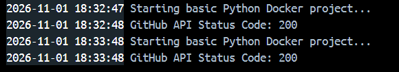

# How to Dockerize
First, you must have Docker installed on the machine. If you are on your work laptop, you will not be able to run/test this. While you can download docker, it will not be able to create the Linux VM using virtualization. If you are testing on a different PC, Docker Desktop must be open and running.

1. Take a look at `main.py`. This application will make a get request to Github and return the status code. It is basically just checking whether or not the Github website is operational or not.
2. To 'dockerize' this application, create a file in the root directory called "Dockerfile". (Note the capitalization and lack of a file extension). Within this file, paste the following:

```Dockerfile
FROM astral/uv:python3.13-bookworm-slim

ENV PYTHONDONTWRITEBYTECODE=1
ENV PYTHONUNBUFFERED=1

WORKDIR /app

COPY pyproject.toml uv.lock ./

RUN uv sync --frozen --no-install-project

COPY . .

CMD ["uv", "run ", "main.py"]
```

If you remember, this is the "recipe" for creating the container so lets break this down step by step.

```Dockerfile
FROM astral/uv:python3.13-bookworm-slim
# Tells the container to install and use Python 3.13-bookworm-slim
# the "slim" tells it to not install the full python (the same as you would install on your pc), but instead, use a smaller version that only contains what is absolutly necessary

# regular python is about 1 GB in size, but slim is only 120 mb.
# there are smaller versions (like alpine), but these don't work well with heavy libraries like pandas

# it also tells the container to also install UV that is compatible with our python version
```

```Dockerfile
ENV PYTHONDONTWRITEBYTECODE=1
ENV PYTHONUNBUFFERED=1
# tells the container to set the environment variables to these values. These values tell python not write any __pycache__ files to save on disk space
```

```Dockerfile
WORKDIR /app
# sets the currest working directory of the container to the folder named 'app'
```

```Dockerfile
COPY pyproject.toml uv.lock ./
# copies the uv.lock file from your project into the container and places it in the main folder
```

```Dockerfile
RUN uv sync --frozen --no-install-project
# runs the command of 'uv init && uv sync' which will create a virtual environment for python.
```

```Dockerfile
COPY . /app
# copies all remaining files into the containers 'app' folder 
# similar to a .gitignore file, docker uses a similar file called .dockerignore that you can create to list any files or folders you do not want copied, like your .venv folder, your .env file, etc.
```

```Dockerfile
CMD ["uv", "run ", "main.py"]
# finally, run the command "uv run main.py" to start the python script.
```

Notice that this script does not end and runs indefinitely via the `while True` loop. If the script stops, the container also stops. When teh container starts, the script will also start. If you needed to start a script on command as designated times, you could use `cron` to set this up (Linux equivalent of `Task Scheduler`).

3. Now create a .dockerignore file and add the following:
```.dockerignore
# dependency managers
/venv

# secrets and variables
.env

# source control and ide configurations
.git
.vscode
.gitignore
.gitattributes

# build artifacts and caches
__pycache__/
*.pyc
*.pyo
*.pyd

# logs and os system dumps
/logs
*.log
Thumbs.db
.DS_Store

# docker specific
Dockerfile*
docker-compose*
.dockerignore
```

4. To build a docker container, you would run the following in your terminal:
```cmd
docker build -t -m "my-python-app" .
```
** 'my-python-app' will be the name of the image**
Your terminal will show the build process and will alert you if there are any issues building it.

If successful, you should see something like this at the bottom:
`View build details: docker-desktop://dashboard/build/desktop-linux/desktop-linux/ap2vxw10l0889z4cebor4o4ec`

You will need to rebuild the container any time you change anything about the project. Rebuilding the container will create a new Docker Image.

5. To start the container, you would run:
```cmd
docker run -d --name my-first-container my-python-app
```
By setting the flag --name with the parameter of "my-first-container" value, you are telling Docker to create a container with the name of "my-first-container" and use the docker image named "my-python-app"

If it worked correctly, Docker Desktop will now display the running container:


You can also see your running containers by running `docker ps` in your terminal. You should get an output like this:

| CONTAINER ID | IMAGE | COMMAND | CREATED | STATUS | PORTS | NAMES |
|---|---|---|---|---|---|---|
| 8080cd750663 | my-python-app | `"uv run main.py"` | 19 seconds ago | Up 18 seconds | | my-python-app |

To view the live logs of the container, you can run `docker logs my-python-app` or check the logs from Docker Desktop.

