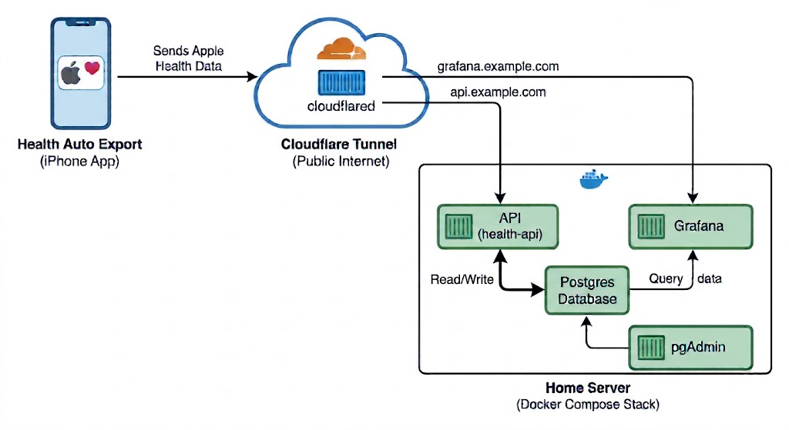

# Real World Application
ALl of this is conceptually very hard to understand, so I want to give you a real world application to help you understand better.

When I first started on my ~fitness journey~, I wanted to be able to look for trends in the data. I was using so many different apps and wanted a consolidated place to see my information. Since all of these apps wrote back to Apple Health, I wanted that to be the source of truth. But how do I get that information off my phone and into a usable format?

Well, I found an app called [Health Auto Export](https://apps.apple.com/us/app/health-auto-export-json-csv/id1115567069) that allows you to export Apple Health data into various formats both manually and on a schedule. Originally, I just had the data exported as a CSV file at the end of each day and the file would be saved to a Google Drive folder, where I'd then use python or excel to concatenate into one file.

As the app got further into development, they added an option to send the data via REST API and figured it would be an interesting challenge for myself. Heres my architecture:

# Architecture Overiew
1. I have a docker compose stack running on my home server that has 4 containers inside of it. They are all on the same network
    - My API
    - Grafana (for dashboarding)
    - Postgres
    - PGAdmin (database GUI)

2. My API needs to be accesible both outside the container AND to the public internet, so I am using a Cloudflare tunnel to host only that container on my domain.

3. I also wanted to be able to see my dashboard, so that container is also exposed to the internet via a Cloudflare tunnel and is accessible on my domain.

If you're feeling nosy, check out the repo [here](https://github.com/DaniellePashayan/autohealthexport_server). But keep in mind that I created this project almost 2 years ago and learned a lot since then, so what I taught you may not actually be present in example. I will eventually go back and make it more robust.